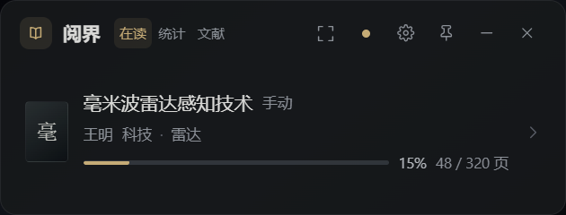
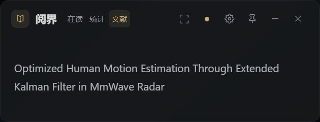
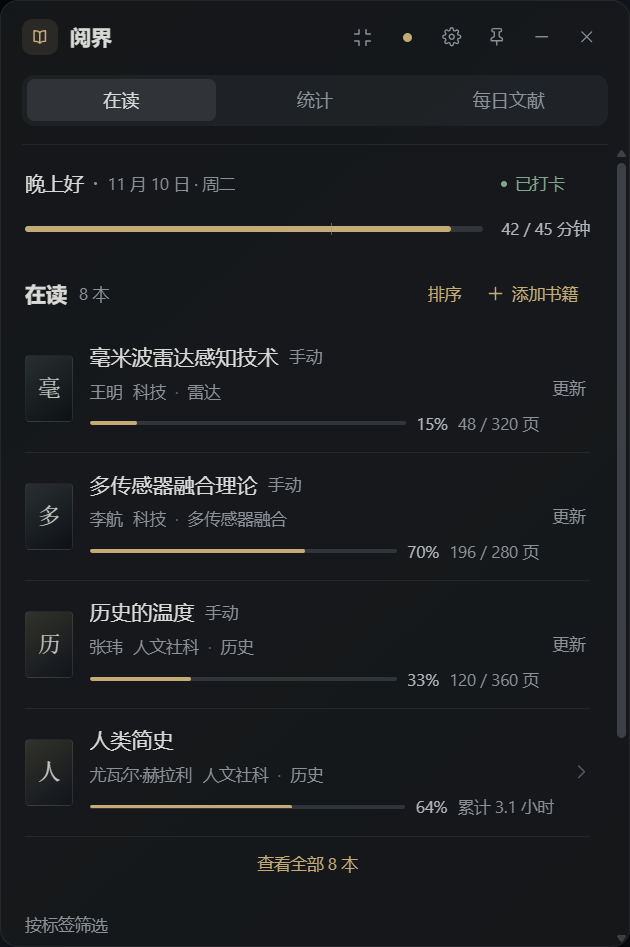
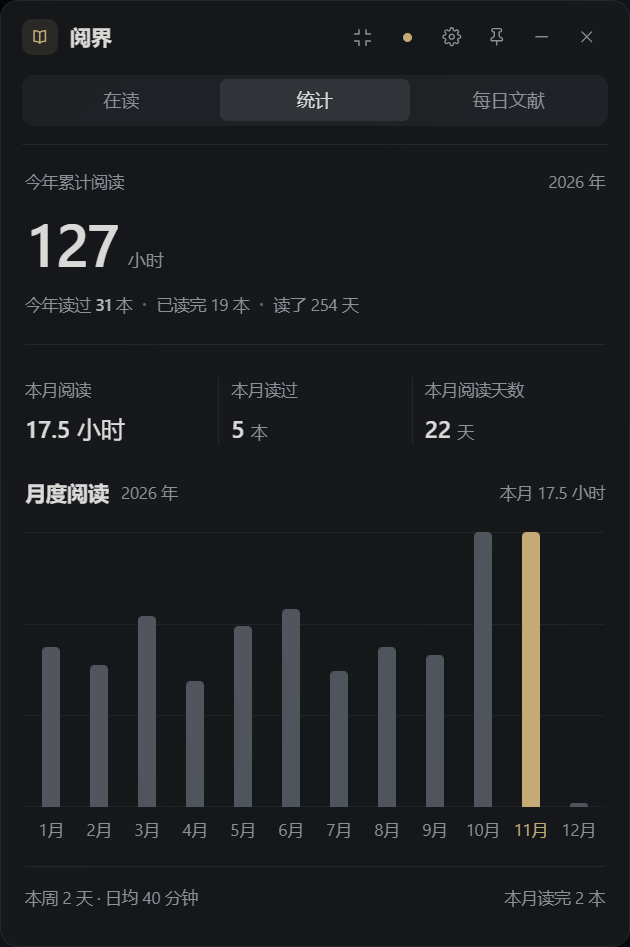
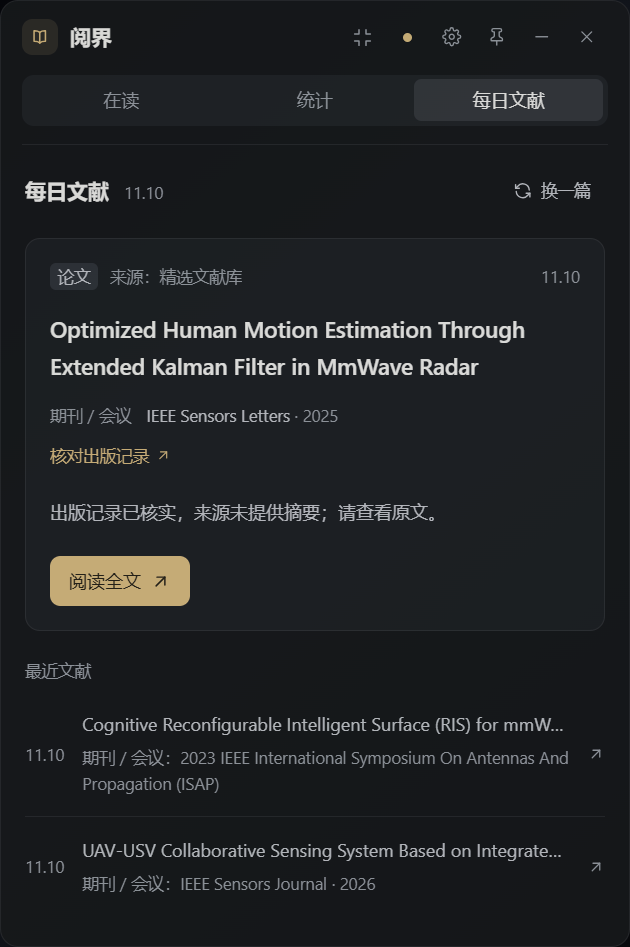
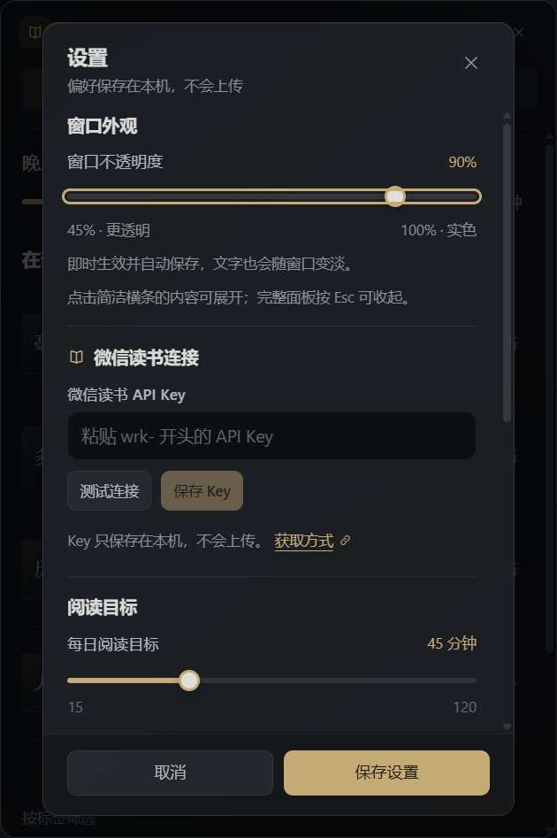
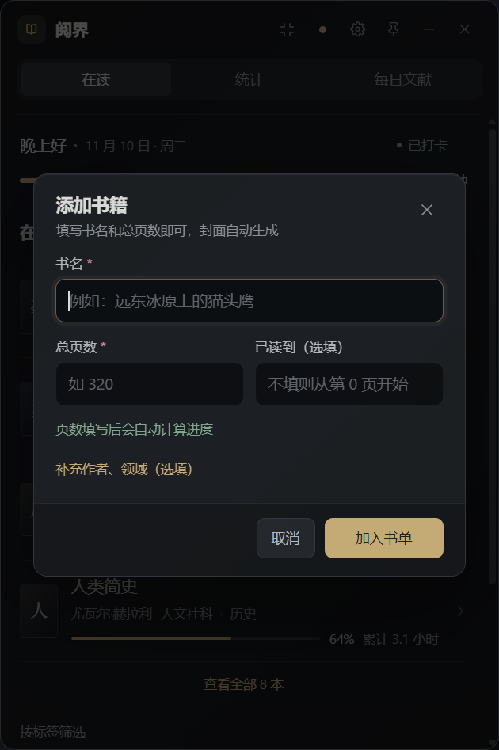

# 阅界 · Readscope

> 常驻桌面的阅读小组件：横条只显示此刻最需要的信息，点开就是完整面板。

Readscope is a Windows desktop reading widget for WeChat Reading and research papers — it tracks your daily reading goal and yearly stats, and recommends one paper or article a day based on your research keywords. Built with Electron, React and Express.

## 截图

简洁横条（默认 420×160，可在三页摘要之间切换）：





点击内容或展开按钮后的完整面板：





设置与添加书籍：




> 以上截图由内置演示数据生成，可复现：`npm run capture`。

## 快速开始

### 环境要求

- Windows 10/11（当前仅针对 Windows 桌面调试，macOS / Linux 未验证）
- Node.js ≥ 20.19（开发使用 Node 24）
- 可选：Google Chrome（"阅读全文"优先用 Chrome 新标签页打开，没有则回退系统默认浏览器）
- 可选：ffmpeg（仅 `npm run test:desktop:visible` 的桌面录屏验收需要）

### 从源码运行

```bash
git clone https://github.com/WUROCK/readscope.git
cd readscope
npm ci
npm start
```

`npm start` 会在缺少 `web/dist` 时自动构建并启动 Electron。Windows 用户也可以双击根目录的 `启动阅界.cmd`，启动器会检查 Node、按需安装依赖与构建，并关闭控制台黑框。

首次启动若没有任何数据，界面会显示内置演示数据；配置微信读书 API Key 后自动切换为真实数据。

开发模式（Vite 热更新 + Electron）：

```bash
npm run dev
```

只启动 API 并在浏览器预览：

```bash
npm run build
npm run server
# 打开 http://127.0.0.1:7411/
```

## 微信读书连接

1. 打开 <https://weread.qq.com/r/weread-skills> 获取 `wrk-` 开头的 API Key；
2. 小组件右上角齿轮 → **微信读书 API Key** → 粘贴 → **测试连接** → **保存设置**；
3. 回到第一页点标题栏同步圆点，或重新打开应用。

> ⚠️ **安全提示**：API Key 以明文保存在本机 `data/settings.json`（该文件已加入 `.gitignore`，不会进入仓库），仅用于请求 `i.weread.qq.com`。请勿把 `data/` 目录、含真实数据的截图或整个项目的 `.zip` 备份提交到公开仓库；Key 泄露后请立即在微信读书页面重置。

Key 只保存在本机，不会上传第三方。应用调用微信读书官方 Agent Gateway 读取书架、单本进度、周/月/年阅读统计；没有 Key 时显示演示数据。

连接成功后：

- 今日时长来自 `/readdata/detail` 每日分桶；
- 最近在读取书架按最近阅读排序的前 6 本，逐本拉取进度与累计阅读时长（兼容真实回包里的 `readingTime` 字段）；
- 今日阅读 ≥ 30 分钟自动写入 `data/checkins.csv`，首次连接会按本月真实数据回填历史打卡；
- 年度统计来自 `mode=annually`，月/年读完本数来自 `readStat` 的"读完"。

## 三个页面

| 页面 | 内容 |
| --- | --- |
| **在读** | 今日分钟数与 45 分钟目标细条、30 分钟自动打卡状态；**微信读书 + 手动书合并的同一份书单**；在读标题旁可添加书籍；每本书显示来源、进度、累计时长或页数、自动标签；列表下方可按标签筛选 |
| **统计** | 今年累计阅读小时、今年读过 / 读完本数、今年阅读天数；本月阅读时长 / 读过本数 / 阅读天数；12 个月柱状图（当前月高亮）；本周节奏 |
| **每日文献** | 每天一篇论文（或公众号文章）：题目、期刊/会议、年份、摘要、标签、"阅读全文"；页面顶部可"换一篇"；下方显示最近文献 |

简洁横条：标题栏可直接切换在读、统计与文献；在读显示排序最前的未读完书籍及进度，未排序时按最近阅读显示；统计显示本周与本月累计；文献只显示标题。点击摘要或展开按钮查看完整页面，按完整面板的收起按钮或 `Esc` 回到横条。切换形态保留当前页和数据，形态、位置、完整面板尺寸及透明度会保存在本机。

窗口可原生拖动、置顶、隐藏到托盘。在设置的"窗口外观"中，可将不透明度调到 **45%–100%**，默认 90%；调整即时生效并自动保存，文字也会随窗口变淡。托盘的"重置窗口外观"可恢复默认值。

完整面板支持触摸横滑、空白处鼠标横拖与键盘 `←` / `→` 切页。更多说明见 [简洁模式与透明度](docs/compact-mode.md) 和 [界面与交互修复说明](docs/interface-fixes.md)。

## 标签是自动分析的

- **微信读书书籍**：根据分类与领域自动生成中文标签，例如「文学-纪实文学」→ `文学 / 纪实`，「文学-外国文学」→ `文学 / 外国文学`，「计算机」→ `科技 / 计算机`，无分类 → `其他`。
- **手动添加的书**：根据书名/作者关键词 + 所选领域自动生成，例如《毫米波雷达感知技术》+ 科技 → `科技 / 雷达 / 感知`；《历史的温度》+ 人文社科 → `人文社科 / 历史`。用户标签会合并去重，最多 6 个。
- 标签会出现在每本书下方，并在书单末尾汇总成可点击的筛选 chips。

## 打卡与阅读目标

- 每日目标默认 **45 分钟**（设置 15–120 可调）；
- 自动打卡阈值默认 **30 分钟**（设置 5–60，且不高于每日目标）；
- 窗口可见时页面每 5 分钟刷新；窗口隐藏/最小化时 Electron 每 10 分钟做一次轻量检查（只拉本周阅读时长），达标自动补打卡；
- 阈值按真实秒数判断，29 分 59 秒不会误打卡；
- 连续天数按"今天（未打卡则从昨天）向前连续"计算。

## 每日文献

推荐来源可在设置中选择：**论文（默认）/ 自动 / 公众号 / 精选库**。

- **论文**：优先检索 Crossref 的正式期刊、会议出版记录；网络不可用时回退核验过的精选库，最后再尝试 arXiv；
- **公众号**：内置 `wechat-article-search` skill 脚本，按中文关键词检索并清洗搜狗摘要；
- **精选库**：`data/seed/curated_papers.json` 中 36 篇 RIS / 毫米波 / ISAC / 人体感知论文，均有 Crossref 出版记录、期刊或会议名及 DOI，离线也可显示出处；来源没有提供摘要时会明确说明；
- 每条推荐追加到 `data/recommendations.csv`（UTF-8 BOM），以归一化 URL + 标题双重去重；
- "阅读全文"优先用 **Google Chrome** 打开新标签页（找不到 Chrome 时回退系统默认浏览器）；微信读书的阅读链接也支持。

文献卡片分别显示**来源**与**期刊 / 会议**，完整展示名称和正式发表年份，并提供"核对出版记录"入口。旧的今日预印本记录会按 DOI 或严格匹配的标题补查；仍未命中时优先推荐有出版出处的论文，保留原历史。未核实的预印本不会编造期刊名称或发表年份。详见 [文献出处与补查](docs/publication-sources.md)。

## 数据文件

数据默认位于项目的 `data/` 目录（可用环境变量 `READSCOPE_DATA_DIR` 指向别处）。除 `data/seed/` 外，其余内容均在 `.gitignore` 中，不会进入仓库。

| 路径 | 内容 |
| --- | --- |
| `data/settings.json` | 微信读书 Key、目标、打卡阈值、推荐来源、研究关键词（本机，含明文 Key） |
| `data/books.json` | 手动书单（页数进度 + 自动/用户标签） |
| `data/papers.json` | 文献阅读状态与进度（`todo` / `reading` / `done`） |
| `data/checkins.csv` | 打卡记录 |
| `data/recommendations.csv` | 每日文献历史与去重记录 |
| `data/cache/` | 微信读书和公开出版记录缓存 |
| `data/seed/curated_papers.json` | 36 篇带 DOI 和出版出处的精选论文（只读，可自行补充） |

## 常用命令

```bash
npm run dev        # Vite + Electron 开发模式
npm start          # 生产模式启动桌面小组件（缺少 web/dist 时自动构建）
npm run build      # 只构建前端 web/dist
npm run server     # 只启动 API（7411）并托管 web/dist
npm test           # 服务端回归测试（67 项）
npm run test:desktop      # 窗口形态、尺寸和透明度回归（19 项）
npm run test:reading      # 阅读顺序纯函数回归（5 项）
npm run typecheck  # TypeScript 检查
npm run check      # typecheck + test + test:desktop + test:reading + build
npm run test:ui    # 隐藏窗口交互与截图检查（需真实桌面环境）
npm run test:recommendations:live  # 十次真实出版记录推荐检查（会访问网络）
npm run capture    # 用演示数据离屏截图到 artifacts/screenshots/
```

## 目录结构

```
electron/          Electron 主进程、preload、无边框/可拖拽窗口、托盘、截图脚本
server/            Express API、微信读书客户端、标签/统计、打卡、推荐
web/               React + TypeScript 三页炭灰阅读界面（Vite）
data/              本机数据 + 精选库 seed
vendor/            内置的 wechat-article-search skill 脚本（MIT）
docs/              API 契约、设计说明、验收截图
scripts/           启动、开发、截图、构建 seed 的脚本
```

> 测试文件位于 `server/tests/`、`electron/tests/`、`web/tests/`。

## 技术说明

- 窗口：Electron 无边框，简洁模式默认 **420×160**，完整模式默认 **420×630**。两种形态共享宽度，仅改变高度；完整面板支持 400–800 × 520–1200，简洁模式固定高度 160。保持原生窗口样式和深色背景，避免切换模式时重建边框。
- 视觉：炭灰 `#16181b`，暖黄重点色 `#d8bb80`；正文 13px、书名 14px、辅助文字 11–12px。移除扫描线、网格、发光和重复的样式覆盖。
- 拖动：标题栏使用 `-webkit-app-region: drag`，按钮和导航排除拖动。内容区仅在确认横向手势后捕获指针，普通点击、纵向滚动与切页分别处理。
- 运行形态：生产模式下 Electron 主进程内直接启动 Express（`server/index.mjs`），页面与 API 同源，端口由系统分配。
- 网络：微信读书网关使用 Node 原生 fetch（Chromium 网络栈访问 `i.weread.qq.com` 会超时），arXiv/公众号请求使用 Electron `net.fetch` 继承系统代理。
- 标签、自动打卡与年度统计均有单元测试覆盖。

## 常见问题

**手动添加的书没有出现？** 新增/编辑/删除链路会直接显示后端错误（不会静默失败）。新增时总页数占位为"如 320"，不是已填值。

**"阅读全文"没有打开 Chrome？** 会优先调用 `chrome.exe` 新标签页；若没有安装 Chrome，则回退系统默认浏览器。

**同步失败 / 连接超时？** 微信读书接口偶尔慢；页面会展示上次缓存。点顶部同步圆点或"刷新"重试；需要时检查网络/代理。

**推荐第一次加载慢？** 实时 arXiv / 公众号检索最坏约 15 秒；选"精选库"可离线秒出。

**换电脑怎么迁移？** 复制整个 `data/` 目录即可（其中 `settings.json` 含明文 Key，只在你自己的机器之间传输）。

## 简洁模式与书籍排序

- 简洁模式标题栏的"在读 / 统计 / 文献"可直接切换摘要。点击内容或展开按钮进入对应完整页面。
- 在读摘要显示优先级最高的未读完书籍；完整在读页保留今日时长与目标进度。统计摘要显示本周与本月累计，避免重复展示今日目标。
- 在完整在读页点击"排序"，拖动书籍或使用上下按钮调整，完成后点"完成排序"。顺序自动保存至 `data/settings.json` 的 `readingOrder`，支持微信读书和手动书单；简洁摘要同步采用该顺序。新书追加在已排序书籍之后，点击"恢复最近阅读"可恢复默认顺序。
- 排序保存失败会显示错误，列表保留上次成功保存的顺序。

Windows 展开过程的底部灰白横带已增加真实桌面录屏检查，详见 [窗口白带修复与验证](docs/window-white-flash.md)。`npm run test:desktop:visible` 可在已安装 ffmpeg 的 Windows 桌面上复查。

## 纸质书快速记录

- 添加时只需书名和总页数，当前页默认 0；书名后按 Enter 进入总页数，再按 Enter 即可加入。作者和领域在"补充作者、领域（选填）"中填写。封面自动使用书名字样，无需上传。
- 点手动书的"更新"，当前页会自动选中，输入后按 Enter 保存；"+10 页""+20 页"会增加页数并直接保存，最多到末页。"标记读完"一次保存到末页。
- 已完成书籍从在读计数、排序和简洁摘要中移出，保存在页面下方"已读完"；展开后会滚动到书单。修改为未到末页的页数可重新放回在读。
- 未到末页最多显示 99%，避免 319/320 页四舍五入成 100% 的误导。完成按真实页数判断。
- `npm run test:ui:books` 验证添加、快捷进度、归档与恢复等 20 项界面流程，使用隔离测试数据，不修改个人书单。

## 已知限制

- 当前为源码运行方案，未提供 exe 安装包；
- 公众号真实链接受微信反爬影响，部分会回退为搜狗跳转链接（浏览器仍可打开）；
- 英文 arXiv 摘要不自动翻译，按约 140 字符截断；
- 微信读书数据依赖官方 API Key，Key 失效时回退演示数据；
- 接口契约见 [API 契约](docs/api-contract.md)。

## 致谢与第三方

- [wechat-article-search](https://github.com/zjp1997720/wechat-article-search)（MIT）：文章搜索脚本置于 `vendor/wechat-article-search/`，许可证随目录保留。
- [Tencent/WeChatReading](https://github.com/Tencent/WeChatReading)（Apache-2.0）：仅参考其公开的 Agent Gateway 文档，**未复制其代码**。
- 数据来源：微信读书 Agent Gateway、Crossref、arXiv、搜狗微信搜索。

> 本项目为个人开源项目，与腾讯及其"微信读书"产品无隶属、合作或官方背书关系；"微信读书"是其权利人商标，此处仅作说明性使用。请自行申请 API Key 并遵守其服务条款。

## License

[MIT](LICENSE) © 2026 WUROCK
